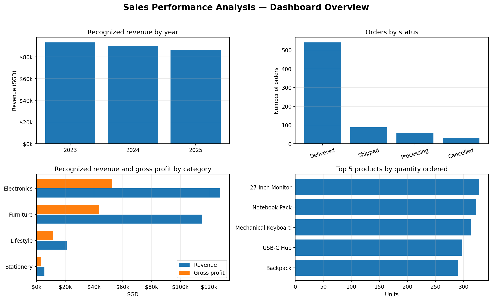

# Introduction

This beginner-friendly project explores a fictional sales database using SQL and simple data analysis. The goal is to practice asking business questions, joining related tables, filtering records, aggregating results, and explaining what the numbers mean.

The dataset contains synthetic customer, order, order-item, product, and region records. These figures are practice data and must not be presented as real company performance.

# Tools I Used

- PostgreSQL — querying, filtering, joining tables, grouping, and calculating sales metrics.

- SQL — SELECT, WHERE, JOIN, GROUP BY, ORDER BY, aggregate functions, date filtering, and CASE/conditional logic where appropriate.

- CSV files — source data for customers, orders, order items, products, and regions.

- ChatGPT - for dashboard and charts.

# Dataset Overview

| File              |  Rows | Purpose                                                       |
| ----------------- | ----: | ------------------------------------------------------------- |
| `customers.csv`   |   150 | Customer details and signup dates                             |
| `orders.csv`      |   720 | Order dates, customer IDs, and order statuses                 |
| `order_items.csv` | 1,822 | Products, quantities, selling prices, and discounts per order |
| `products.csv`    |    15 | Product categories, unit costs, and list prices               |
| `regions.csv`     |     5 | Region reference data                                         |

# SQL Practice Questions

### 1. How many customers are in the database?

```sql
SELECT
    COUNT(*) AS number_of_customers
FROM customers
```

There are 150 customers.

### 2. How many orders were placed in each year?

```sql
SELECT
    COUNT(order_id) AS total_orders,
    EXTRACT(YEAR FROM order_date) AS year
FROM
    orders
GROUP BY
    year
ORDER BY
    year ASC
```

| year | total_orders |
| ---: | -----------: |
| 2023 |          248 |
| 2024 |          236 |
| 2025 |          236 |

### 3.What are the five most frequently ordered products by total quantity?

```sql
SELECT
    p.product_name AS products,
    SUM(oi.quantity) AS total_quantity
FROM order_items oi
JOIN products p ON oi.product_id = p.product_id
GROUP BY
    p.product_name
ORDER BY
    total_quantity DESC
LIMIT 5
```

| products            | total_quantity |
| ------------------- | -------------: |
| 27-inch Monitor     |            328 |
| Notebook Pack       |            322 |
| Mechanical Keyboard |            314 |
| USB-C Hub           |            298 |
| Backpack            |            290 |

### 4. How many orders are in each order status?

```sql
SELECT
    COUNT(order_status) AS total_order,
    order_status
FROM
    orders
GROUP BY
    order_status
ORDER BY
    total_order DESC
```

| order_status | total_order |
| ------------ | ----------: |
| Delivered    |         541 |
| Shipped      |          88 |
| Processing   |          59 |
| Cancelled    |          32 |
| **Total**    |     **720** |

### 5. Which customers signed up during 2024?

```sql
SELECT
    customer_name,
    signup_date
FROM
    customers
WHERE
    signup_date >= '2024-01-01' AND
    signup_date < '2025-01-01'
ORDER BY
    signup_date DESC
```

38 customers have a signup_date in 2024. The analysis filters the signup date to the calendar year 2024.

### 6. What is the average list price by product category?

```sql
SELECT
    category,
    ROUND(AVG(list_price)::NUMERIC, 2) AS avg_price
FROM
    products
GROUP BY
    category
ORDER BY
    avg_price DESC
```

| category    | avg_price |
| ----------- | --------: |
| Furniture   |   $182.33 |
| Electronics |    $86.00 |
| Lifestyle   |    $30.67 |
| Stationery  |     $7.83 |

### 7. How many customers are there in each city?

```sql
SELECT
    COUNT(customer_id) AS total_customer,
    city
FROM
    customers
GROUP BY
    city
ORDER BY
    total_customer DESC
```

| city        | total_customer |
| ----------- | -------------: |
| Bedok       |             22 |
| Tampines    |             20 |
| Bishan      |             18 |
| Queenstown  |             16 |
| Ang Mo Kio  |             15 |
| Singapore   |             15 |
| Jurong East |             14 |
| Punggol     |             12 |
| Clementi    |             12 |
| Woodlands   |              6 |

### 8. What are the 10 most recent orders with customer names and statuses?

```sql
SELECT
    o.order_date,
    o.order_status,
    c.customer_name
FROM
    orders o
INNER JOIN customers c ON o.customer_id = c.customer_id
GROUP BY
    o.order_date,
    o.order_status,
    c.customer_name
ORDER BY
    o.order_date DESC
LIMIT 10
```

| order_date | customer_name | order_status |
| ---------- | ------------- | ------------ |
| 2025-12-31 | Amelia Tan    | Delivered    |
| 2025-12-31 | Isla Koh      | Delivered    |
| 2025-12-30 | Emma Wong     | Delivered    |
| 2025-12-28 | Ryan Ho       | Delivered    |
| 2025-12-26 | Kai Lim       | Delivered    |
| 2025-12-23 | Noah Teo      | Delivered    |
| 2025-12-21 | Aiden Ho      | Delivered    |
| 2025-12-19 | Liam Yeo      | Shipped      |
| 2025-12-16 | Dylan Teo     | Delivered    |
| 2025-12-15 | Dylan Chen    | Delivered    |

### 9. What is total recognized revenue by year?

```sql
SELECT
    EXTRACT(YEAR FROM o.order_date) AS years,
    ROUND(SUM(oi.quantity * oi.unit_price)::NUMERIC, 2) AS total_revenue
FROM
    orders o
JOIN order_items oi ON o.order_id = oi.order_id
WHERE
    o.order_status = 'Delivered'
GROUP BY
    years
ORDER BY
    years
```

|     years |   total_revenue |
| --------: | --------------: |
|      2023 |      $86,430.80 |
|      2024 |      $79,658.00 |
|      2025 |      $77,177.83 |
| **Total** | **$243,266.63** |

### 10. What are revenue, cost, gross profit, and gross margin by product category?

```sql
SELECT
    p.category,
    ROUND(SUM(oi.quantity * oi.unit_price)::NUMERIC, 2) AS revenue,
    ROUND(SUM(oi.quantity * p.unit_cost)::NUMERIC, 2) AS total_cost,
    ROUND((
        SUM(oi.quantity * oi.unit_price) -
        SUM(oi.quantity * p.unit_cost)
    )::NUMERIC, 2) AS gross_profit,
    ROUND((
        (
            SUM(oi.quantity * oi.unit_price) -
            SUM(oi.quantity * p.unit_cost)
        ) / NULLIF(SUM(oi.quantity * oi.unit_price), 0) * 100
    )::NUMERIC, 2) AS gross_margin
FROM
    order_items oi
INNER JOIN
    products p ON oi.product_id = p.product_id
GROUP BY
    p.category
ORDER BY
    gross_profit DESC
```

| category    |         revenue |     total_cost |    gross_profit | gross_margin |
| ----------- | --------------: | -------------: | --------------: | -----------: |
| Electronics |     $153,231.16 |     $84,304.00 |      $68,909.16 |       44.98% |
| Furniture   |     $143,481.38 |     $83,064.00 |      $60,417.38 |       42.11% |
| Lifestyle   |      $25,938.87 |     $11,115.00 |      $14,823.87 |       57.15% |
| Stationery  |       $6,569.13 |      $2,963.80 |       $3,605.33 |       54.88% |
| **Total**   | **$329,220.54** | **$181,446.8** | **$147,755.74** |  **199.12%** |

## Analysis and Key Findings

|             Analysis |                                        Key finding |
| -------------------: | -------------------------------------------------: |
|            Customers |                           150 registered customers |
|         Order volume |                     2023 had the most orders (248) |
|              Revenue |      2023 generated the highest recognized revenue |
| Best-selling product |                        27-inch Monitor (328 units) |
|         Order status |                          541 orders were delivered |
|     Customer signups |                        38 customers joined in 2024 |
|      Product pricing |       Furniture has the highest average list price |
|    Customer location |                       Bedok has the most customers |
|     Category revenue | Electronics generated the highest category revenue |
|         Gross margin | Lifestyle has the highest reported margin (57.15%) |

## Dashboard Overview



## Dataset note:

All records are synthetic and intended for practice and these are all generate by AI. Do not describe them as actual company results.
